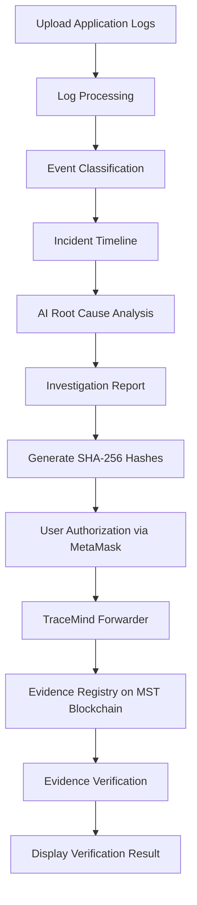

<h1 align="center">TraceMind</h1>
<h3 align="center">AI-Powered Incident Investigation with Blockchain-Verified Evidence</h3>

<p align="center">
  <strong>Find the cause. Verify the evidence. Build trust.</strong>
</p>

<p align="center">
  
  
  
  
  
  
  
</p>

TraceMind is an AI-powered incident investigation platform that helps developers identify possible causes of application failures. It collects logs from different services, creates an incident timeline, and suggests possible root causes with supporting evidence.

It integrates **MST Blockchain** to register and verify the digital fingerprints of incident logs and AI-generated investigation reports. This helps detect whether evidence has been modified after an investigation.

---

## 📑 Table of Contents

- [Live Demo](#-live-demo)
- [Problem Statement](#-problem-statement)
- [Proposed Solution](#-proposed-solution)
- [Key Features](#-key-features)
- [System Workflow](#-system-workflow)
- [System Architecture](#️-system-architecture)
- [Technology Stack](#️-technology-stack)
- [MST Blockchain Integration](#️-mst-blockchain-integration)
- [Project Structure](#-project-structure)
- [Installation and Setup](#️-installation-and-setup)
- [Deployment](#-deployment)
- [Security and Evidence Integrity](#-security-and-evidence-integrity)
- [Target Users](#-target-users)
- [Future Improvements](#-future-improvements)
- [Project Information](#-project-information)

---

## 🚀 Live Demo

| Resource | Link |
|---|---|
| **Frontend** | https://trace-mind-lilac.vercel.app/ |
| **Backend API** | https://tracemind-backend-h192.onrender.com |
| **API Documentation** | https://tracemind-backend-h192.onrender.com/docs |
| **GitHub Repository** | https://github.com/Asmi-Rajbhar/TraceMind |

## 📌 Problem Statement

Modern applications consist of multiple connected services. When one service fails, it can affect other services and create a chain of failures.

Finding the actual cause is difficult because:

- Logs are generated by different services.
- Developers need to manually examine large amounts of log data.
- A failure in one service can cause problems in other services.
- Investigation reports and logs may be modified after an incident.

This makes incident investigation time-consuming and makes it difficult to maintain trust in the evidence.

## 💡 Proposed Solution

TraceMind simplifies incident investigation through AI-based log analysis and blockchain-based evidence verification.

The platform:

1. Collects application logs in JSON format.
2. Organizes events into a chronological timeline.
3. Analyzes log messages and service failures.
4. Identifies possible root causes and supporting evidence.
5. Generates an investigation report.
6. Registers SHA-256 hashes of logs and reports on MST Blockchain.
7. Verifies evidence integrity by comparing newly generated hashes with the hashes registered on the blockchain.

## ✨ Key Features

### 1. Log Upload
- Upload application logs in JSON format.
- Process events generated by multiple services.
- Extract timestamps, service names, severity levels, and messages.

### 2. Incident Timeline
- Display events in chronological order.
- Identify important events and failures.
- Understand how an issue spreads across different services.

### 3. AI-Based Root Cause Analysis
- Analyze application logs to identify possible failures.
- Suggest likely root causes.
- Display supporting log evidence.
- Show alternative possible causes and investigation details.

### 4. Investigation Reports
- Generate structured incident investigation results.
- Present the identified problem, possible root cause, and supporting evidence.

### 5. Blockchain Evidence Registration
- Generate SHA-256 fingerprints of incident logs and investigation reports.
- Register evidence hashes on MST Blockchain.
- Maintain an on-chain record of evidence registration.

### 6. Evidence Verification
- Verify whether the original logs and reports match their registered hashes.
- Detect modifications to previously registered evidence.
- Display the verification result.

### 7. Gasless Transactions
- Integrate ERC-2771 meta-transactions.
- Allow users to authorize transactions through MetaMask.
- Use a relayer to submit authorized transactions and pay gas fees.

## 🔄 System Workflow



## 🏗️ System Architecture

TraceMind consists of three main components:

**1. Frontend**
- Provides the dashboard and user interface.
- Supports log uploads and investigation results.
- Displays incident timelines and root cause analysis.
- Integrates MetaMask for transaction authorization.

**2. Backend**
- Processes and normalizes application logs.
- Performs incident analysis.
- Generates investigation reports.
- Calculates SHA-256 hashes.
- Communicates with MST Blockchain smart contracts.

**3. Blockchain Layer**
- Registers evidence hashes.
- Records the registering user's address.
- Supports relayed transactions.
- Verifies evidence integrity.

## 🛠️ Technology Stack

| Component | Technologies |
|---|---|
| Frontend | Next.js, React.js, TypeScript |
| Styling | CSS |
| Backend | Python, FastAPI |
| Log Processing | Python, JSON |
| Blockchain | MST Blockchain |
| Smart Contracts | Solidity |
| Smart Contract Development | Hardhat, OpenZeppelin |
| Wallet Integration | MetaMask, Wagmi |
| Transaction Standard | ERC-2771 |
| Evidence Hashing | SHA-256 |
| Backend Deployment | Render |
| Frontend Deployment | Vercel |

## ⛓️ MST Blockchain Integration

TraceMind uses MST Blockchain to maintain the integrity of incident investigation evidence.

Instead of storing complete logs and reports on-chain, the platform stores their SHA-256 hashes. This keeps the actual evidence off-chain while providing a way to verify whether it has changed.

### Smart Contracts

The project contains three deployed smart contracts:

| Smart Contract | Address | Purpose |
|---|---|---|
| EvidenceRegistry (Original) | `0x39cC2195a7c11BC1CD9FBA5792A75464B604Bdd9` | Original direct evidence registration contract |
| TraceMindForwarder | `0xbbA8112b84342320aA90108d922fB6E7718E7A2E` | Handles ERC-2771 meta-transactions |
| EvidenceRegistry2771 | `0x7EC945b74B686a51B2f0469CD48f3113a8dfBFe2` | Registers and verifies evidence using the trusted forwarder |

> **Current implementation:** The relayed evidence registration flow uses `TraceMindForwarder` and `EvidenceRegistry2771`.

### Network Details

| Setting | Value |
|---|---|
| Network | MST Testnet |
| Chain ID | `91562037` |
| RPC URL | `https://testnetrpc.mstblockchain.com` |

### Transaction Flow

1. TraceMind generates hashes for the incident logs and investigation report.
2. The user connects MetaMask and authorizes the transaction.
3. The frontend sends the signed authorization to the backend.
4. The relayer submits the transaction through `TraceMindForwarder`.
5. `EvidenceRegistry2771` registers the evidence hashes on MST Blockchain.
6. The platform can later verify the evidence against the registered hashes.

## 📂 Project Structure

```text
TraceMind/
│
├── backend/
│   ├── main.py
│   ├── services/
│   │   ├── blockchain.py
│   │   ├── hashing.py
│   │   └── relayer.py
│   └── sample_logs/
│
├── packages/
│   ├── contracts/
│   │   ├── contracts/
│   │   │   ├── EvidenceRegistry.sol
│   │   │   ├── EvidenceRegistry2771.sol
│   │   │   └── TraceMindForwarder.sol
│   │   ├── scripts/
│   │   ├── test/
│   │   └── hardhat.config.ts
│   │
│   ├── frontend/
│   │   ├── app/
│   │   ├── components/
│   │   └── lib/
│   │
│   └── shared/
│
├── package.json
├── pnpm-workspace.yaml
├── .gitignore
└── README.md
```

## ⚙️ Installation and Setup

### Prerequisites

Make sure you have installed:

- Node.js
- pnpm
- Python 3
- Git
- MetaMask browser extension

### 1. Clone the Repository

```bash
git clone https://github.com/Asmi-Rajbhar/TraceMind.git
cd TraceMind
```

### 2. Backend Setup

Navigate to the backend directory:

```bash
cd backend
```

Create a Python virtual environment:

```bash
python3 -m venv .venv
```

Activate it:

```bash
source .venv/bin/activate
```

Install dependencies:

```bash
pip install -r requirements.txt
```

Configure the required backend environment variables in a local `.env` file. Refer to the backend configuration for the required variable names.

Start the backend:

```bash
python -m uvicorn main:app --reload --port 8000
```

Backend will run at:

```text
http://localhost:8000
```

API documentation:

```text
http://localhost:8000/docs
```

### 3. Frontend Setup

Open another terminal and navigate to the frontend package:

```bash
cd TraceMind/packages/frontend
```

Install dependencies using pnpm:

```bash
pnpm install
```

Create a `.env.local` file and configure:

```env
NEXT_PUBLIC_API_BASE_URL=http://localhost:8000
```

Start the frontend:

```bash
pnpm dev
```

Frontend will run at:

```text
http://localhost:3000
```

### 4. Smart Contract Setup

Navigate to the contracts package:

```bash
cd packages/contracts
```

Install dependencies:

```bash
npm install
```

Configure the required blockchain environment variables locally before running contract scripts.

Compile the contracts:

```bash
npx hardhat compile
```

Run contract tests:

```bash
npx hardhat test
```

> **Note:** The contracts listed above have already been deployed to MST Testnet. The deployment commands are provided for development and testing purposes. Do not redeploy unless required.

## 🌐 Deployment

TraceMind uses separate deployment platforms for its frontend and backend.

| Component | Platform | Deployment |
|---|---|---|
| Frontend | Vercel | https://trace-mind-lilac.vercel.app/ |
| Backend | Render | https://tracemind-backend-h192.onrender.com |
| Smart Contracts | MST Blockchain Testnet | Deployed |

For frontend deployment, configure:

```env
NEXT_PUBLIC_API_BASE_URL=https://tracemind-backend-h192.onrender.com
```

The backend CORS configuration must allow the deployed frontend domain.

## 🔐 Security and Evidence Integrity

- Private keys and sensitive environment variables must never be committed to GitHub.
- Actual incident logs and reports remain off-chain.
- SHA-256 hashes are used to identify changes in registered evidence.
- MetaMask is used for user transaction authorization.
- The relayer handles transaction submission and gas fees.

> **Important:** Blockchain verification confirms whether the evidence matches the registered hash. It does not independently prove that the original logs were truthful or that an AI-suggested root cause is correct.

## 🎯 Target Users

- Software Developers
- Backend Developers
- DevOps Engineers
- IT Support Teams
- Incident Response Teams
- Organizations managing distributed applications

## 🔮 Future Improvements

- Support for real-time log streaming.
- Integration with monitoring platforms.
- Advanced AI-based root cause analysis.
- Support for more log formats and services.
- Incident notifications and alerting.
- Enhanced investigation history and analytics.
- Migration to additional blockchain networks when required.

## 👩‍💻 Project Information

| | |
|---|---|
| **Project Name** | TraceMind |
| **Project Title** | AI-Powered Incident Investigation with Blockchain-Verified Evidence |
| **Hackathon** | MST Blockchain BUILDATHON 2.0 |
| **Blockchain Network** | MST Testnet |
| **Developer** | Asmi Rajbhar |

---

<p align="center">
  <em>TraceMind combines AI-based incident investigation with blockchain-based evidence verification to make application failure analysis more organized, transparent, and trustworthy.</em>
</p>
